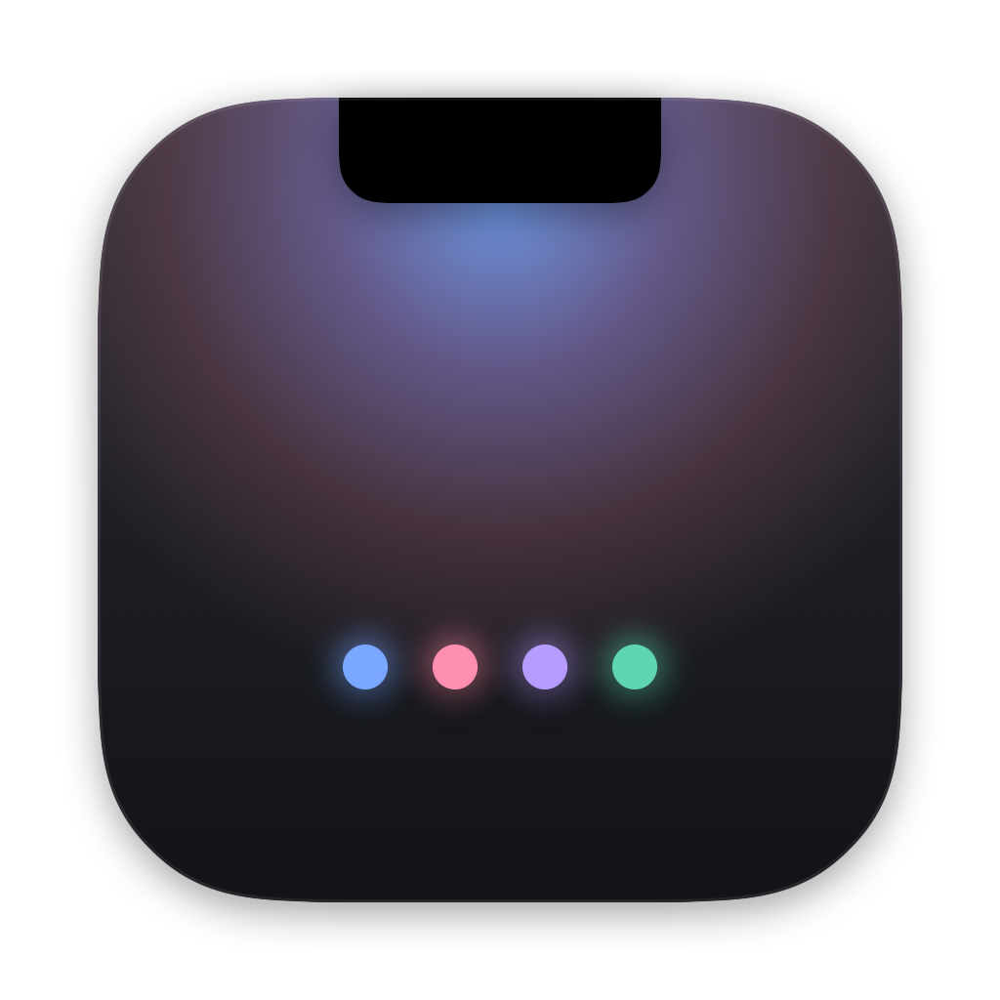
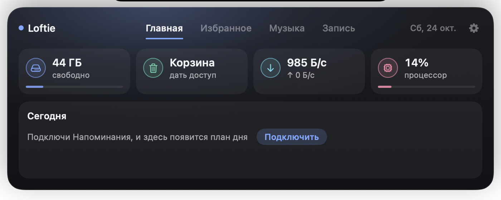
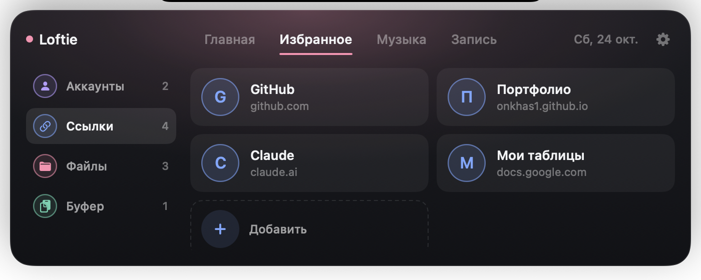
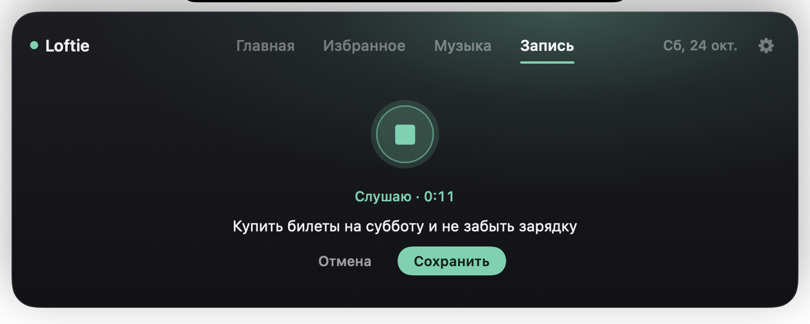

<p align="center"></p>

<h1 align="center">Loftie</h1>

<p align="center">Всё нужное — прямо в челке MacBook. Бесплатно и с открытым кодом.</p>

<p align="center"></p>

## Что умеет

Наведи курсор на челку — под ней выедет панель. Уведёшь курсор — спрячется. Никаких горячих клавиш.

- **Статусы всегда на виду.** По бокам от челки: свободное место на диске, размер корзины, скорость сети и загрузка процессора.
- **Главная.** Те же статусы крупно и план на сегодня из Напоминаний: отмечай выполненное и добавляй новое прямо из панели.
- **Избранное.** Аккаунты (клик — логин скопирован), ссылки, файлы и программы. И **буфер обмена**: последние 5 скопированных текстов, чтобы не потерять нужное. Пароли из менеджеров паролей туда не попадают.
- **Музыка.** Трек, исполнитель, обложка и прогресс из любого плеера — Яндекс Музыка, Spotify, Apple Music или вкладка браузера.
- **Запись.** Нажал на микрофон, надиктовал мысль — она легла заметкой во «Входящие» твоего хранилища Obsidian. Без Obsidian — в папку «Документы/Loftie».
- **Строка меню.** Спрятал значок программы системной настройкой — открывай её из шестерёнки Loftie.

<p align="center">
  
  
</p>

## Установка

```bash
brew install onkhas1/tap/loftie
```

Обновление — `brew upgrade loftie`, удаление — `brew uninstall loftie`.

<details>
<summary>Нет Homebrew?</summary>

```bash
curl -fsSL onkhas1.github.io/loftie/install | sh
```

Скрипт скачает последнюю версию, положит Loftie в «Программы» и запустит. Тем же способом обновляешься.

Или вручную: скачай `Loftie-*.zip` со страницы [Releases](https://github.com/onkhas1/loftie/releases), распакуй и перетащи в «Программы». Loftie не подписан платным сертификатом Apple, поэтому при первом запуске нажми на него правой кнопкой → «Открыть».
</details>

**Нужно:** macOS 14 Sonoma или новее. Лучше всего на MacBook с челкой; на других Маках Loftie рисует свою «челку» по центру строки меню.

### Удаление

Выйди из Loftie (шестерёнка → «Выйти из Loftie») и удали `Loftie.app` из «Программ». Данные лежат в `~/Library/Application Support/Loftie`.

## Доступы и приватность

Loftie ничего никуда не отправляет. Все данные — на твоём Маке.

| Доступ | Зачем | Когда спросит |
|---|---|---|
| Напоминания | план на сегодня | при подключении на Главной |
| Полный доступ к диску | только чтобы посчитать размер корзины | по желанию |
| Микрофон и распознавание речи | запись мыслей голосом (распознаёт Apple, как обычная диктовка) | при первой записи |

Иконки сайтов в избранном подгружаются с сервиса иконок DuckDuckGo: туда уходит только адрес сайта.

Как Loftie видит музыку: начиная с macOS 15.4 Apple не отдаёт «Сейчас играет» сторонним приложениям. Loftie читает эти данные через маленький мост (`Bridge/nowplaying.m`), который запускается системным `perl`. Код открыт, можно проверить.

## Сборка из исходников

```bash
git clone https://github.com/onkhas1/loftie.git
cd loftie
./build.sh --install
```

Нужен Xcode 16 или новее. `./build.sh --release` собирает универсальный архив для раздачи в `dist/`.

## Автор

Александр Сахно — [Telegram @onkhas](https://t.me/onkhas) · [byonkhas@gmail.com](mailto:byonkhas@gmail.com)

Loftie полностью бесплатный — пользуйся на здоровье. Если зашёл и хочется сказать спасибо, можно [угостить автора чашкой кофе ☕](https://pay.cloudtips.ru/p/1a375628). Это не обязательно.

Лицензия [MIT](LICENSE).
